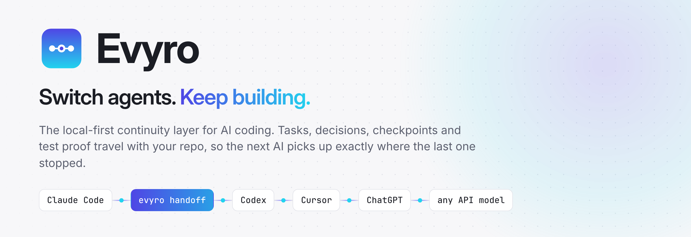
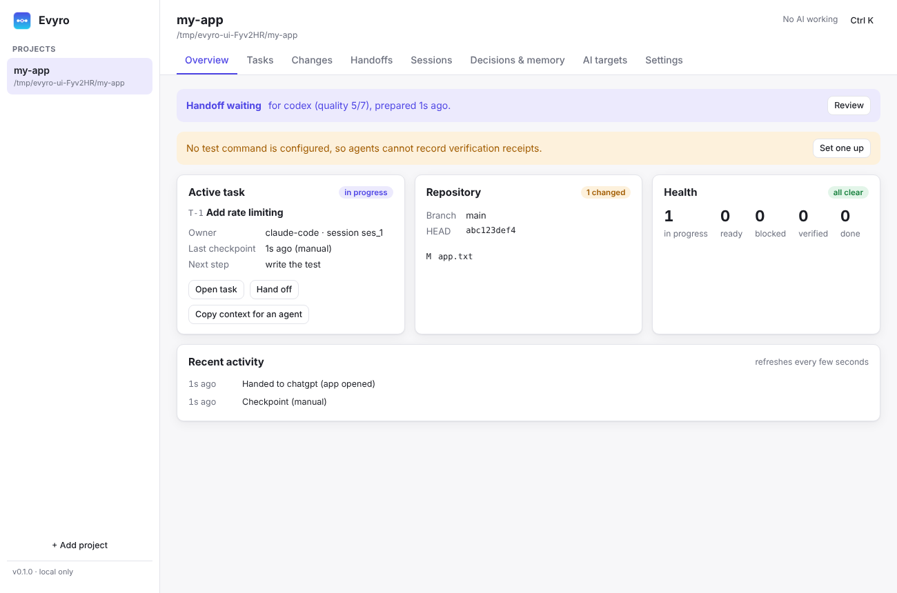
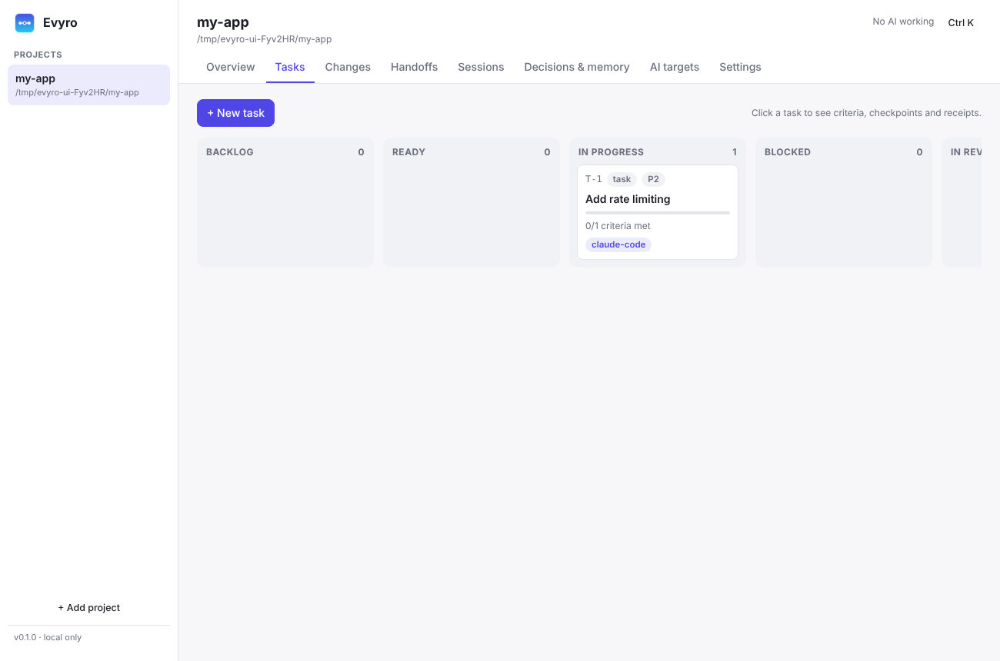
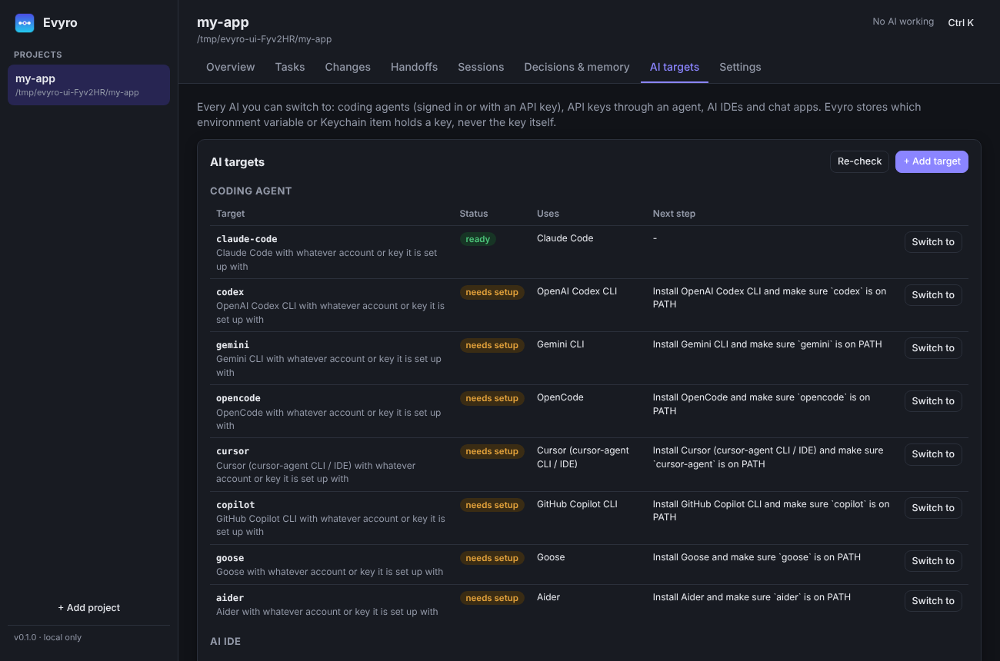

<p align="center">
  <picture>
    <source media="(prefers-color-scheme: dark)" srcset="docs/assets/banner-dark.png">
    
  </picture>
</p>

<p align="center">
  <a href="https://github.com/AINomadDev/evyro/actions/workflows/ci.yml"></a>
  
  
  
  
</p>

<p align="center">
  <a href="docs/user-guide/USER_GUIDE.md"><b>User guide</b></a> ·
  <a href="#quick-start">Quick start</a> ·
  <a href="#how-evyro-is-different">How it is different</a> ·
  <a href="docs/user-guide/CLI_REFERENCE.md">CLI reference</a> ·
  <a href="docs/KNOWN_LIMITATIONS.md">Limitations</a>
</p>

---

Your AI hits a usage limit halfway through a feature. A different AI would be faster for the next part. You want to finish in Cursor, or ask ChatGPT. Every switch usually means re-explaining the task, losing decisions, and trusting "all tests pass" from an AI that never ran them.

**Evyro keeps the work, so you can change the AI.** It stores each repository's tasks, decisions, checkpoints, Git state and test evidence on your machine, and hands them to whichever AI comes next as a signed, checked handoff.

<p align="center">
  <picture>
    <source media="(prefers-color-scheme: dark)" srcset="docs/assets/screen-overview-dark.png">
    
  </picture>
</p>

## Features

### Continuity
- **Signed handoffs.** `evyro switch --to codex` writes an HMAC-signed continuation contract (goal, next step, do-not-redo list, decisions, file hashes) and starts the next agent on it.
- **Drift checks on resume.** Branch, commit and per-file hashes are compared before anyone continues. If the repo moved, Evyro stops and shows you what changed.
- **Checkpoints during the work**, not only at the end: agent hooks, process exit, and `evyro recover` after a crash.
- **Decisions and memory** that every agent sees, so "we chose a token bucket" is said once.

### Any AI, any way you pay
- **Coding agents:** Claude Code, Codex, Gemini CLI, Cursor, Copilot, OpenCode, Goose, Aider.
- **AI IDEs:** Cursor, VS Code, Windsurf, Zed, Antigravity, JetBrains, opened on the task with the handoff on the clipboard.
- **Chat apps:** ChatGPT, Claude, Gemini, Copilot, with a redacted, self-contained chat pack.
- **API keys and local models:** OpenRouter, OpenAI, Anthropic, Ollama and more, through an agent. Keys are read from an env var or the macOS Keychain at launch. **Evyro never stores a key.**

### Proof, not promises
- **Verification receipts.** `evyro verify -- cargo test` runs the tests itself and records the result against the exact code.
- **An evidence gate.** A task becomes *verified* only when every acceptance criterion is met and a passing receipt exists for the current code. An agent saying "done" is recorded as *agent-reported*.
- **Secret redaction** in contracts, context, exports, MCP output and test logs.

### Local-first, everywhere you work
- **CLI, MCP server and a desktop app** on macOS, Windows and Linux, all on one local SQLite database.
- **Desktop app:** overview, task board, a Changes view with the diff, handoff review, sessions, decisions, AI targets, a command palette (⌘K) and live refresh.
- **No cloud account.** Nothing leaves your machine unless you hand it to an AI.

<table>
  <tr>
    <td width="50%"></td>
    <td width="50%"></td>
  </tr>
  <tr>
    <td align="center"><sub>Task board with acceptance criteria</sub></td>
    <td align="center"><sub>Every AI you can switch to, and whether it is ready</sub></td>
  </tr>
</table>

## How Evyro is different

Evyro is not another place to chat with an agent. It is the layer that remembers the work between agents, and it is built to sit next to the tools you already use.

| | **Evyro** | T3 Code | px0 | Relay |
|---|:---:|:---:|:---:|:---:|
| What it is | Continuity layer and task proof | Control plane for running agents | Review workbench and fast browser IDE | Handoff protocol |
| Signed handoff that any AI can continue | ✓ | — | — | ✓ |
| Drift check before resuming | ✓ | — | — | partly |
| Task graph with acceptance criteria | ✓ | — | — | partly |
| "Verified" requires a passing test run on current code | ✓ | — | — | — |
| Switch to an AI IDE, chat app or raw API key | ✓ | partly | — | — |
| Run and chat with agents in one window | planned | ✓ | ✓ | — |
| Review workbench with diff comments | planned | — | ✓ | — |
| Code search and symbols | planned | — | ✓ | — |
| Remote and mobile access | planned | ✓ | — | — |

<sub>✓ has it · partly: some of it · — not its focus. Based on our source review in <a href="docs/research/OPEN_SOURCE_RESEARCH.md">docs/research</a>, November 2026. "Planned" items are in the <a href="docs/BACKLOG.md">backlog</a>; Evyro does not have them yet.</sub>

## Quick start

```bash
# Rust 1.80+ and git required
cargo install --path crates/evyro-cli
evyro doctor
```

Desktop app: `cargo run --release -p evyro-desktop`, or download the installer for your OS from the latest CI run (unsigned for now; see [Known limitations](docs/KNOWN_LIMITATIONS.md)). See the [Desktop guide](docs/user-guide/DESKTOP.md).

### Five-minute tour

```bash
cd ~/code/my-app
evyro init                                   # registers the repo, writes .evyro/ and agent entry files
evyro task add "Add rate limiter" --accept "429 after 10 req/s" --accept "tests pass"
evyro run --to claude-code --task T-1        # launches Claude Code with session tracking

# ...Claude hits its usage limit...
evyro switch --to codex                      # signed handoff, then Codex starts where Claude stopped
evyro switch --to cursor-ide                 # ...or open Cursor with the handoff on the clipboard
evyro switch --to chatgpt                    # ...or a self-contained chat pack for ChatGPT
evyro targets                                # every AI you can switch to, and whether it is ready

evyro verify -- cargo test                   # Evyro runs the tests and records a receipt
evyro task check T-1 1                       # tick off acceptance criteria (or in the desktop app)
evyro task check T-1 2
evyro task update T-1 --status verified      # needs every criterion met and a passing receipt for this exact code
```

Inside an agent session the agent uses the same commands (the generated `AGENTS.md` / `CLAUDE.md` / `GEMINI.md` tell it how) or the MCP server: `claude mcp add evyro -- evyro mcp`.

## Documentation

| Topic | File |
|---|---|
| **User guide (start here)** | [docs/user-guide/USER_GUIDE.md](docs/user-guide/USER_GUIDE.md) |
| CLI reference | [docs/user-guide/CLI_REFERENCE.md](docs/user-guide/CLI_REFERENCE.md) |
| Desktop app | [docs/user-guide/DESKTOP.md](docs/user-guide/DESKTOP.md) |
| Handoff protocol | [docs/protocols/HANDOFF_PROTOCOL.md](docs/protocols/HANDOFF_PROTOCOL.md) |
| MCP server | [docs/protocols/MCP_INTEGRATION.md](docs/protocols/MCP_INTEGRATION.md) |
| Agent support | [docs/AGENT_COMPATIBILITY.md](docs/AGENT_COMPATIBILITY.md) |
| Architecture decisions | [docs/decisions/ARCHITECTURE_DECISIONS.md](docs/decisions/ARCHITECTURE_DECISIONS.md) |
| Research and fork-vs-build | [docs/research/](docs/research/) |
| Performance | [docs/PERFORMANCE.md](docs/PERFORMANCE.md) |
| Backlog | [docs/BACKLOG.md](docs/BACKLOG.md) |
| Limitations | [docs/KNOWN_LIMITATIONS.md](docs/KNOWN_LIMITATIONS.md) |
| Brand guide | [docs/BRAND.md](docs/BRAND.md) |

## Layout

```text
crates/evyro-core   continuity engine (storage, tasks, sessions, checkpoints, handoff, context, memory, verify, adapters)
crates/evyro-mcp    MCP stdio server
crates/evyro-cli    the `evyro` binary + end-to-end scenario tests
crates/evyro-desktop  Tauri 2 desktop app (Rust commands + plain HTML/JS UI in ui/)
schemas/            continuation contract JSON Schema
docs/               research, ADRs, protocols, guides
```

## License

MIT OR Apache-2.0.
